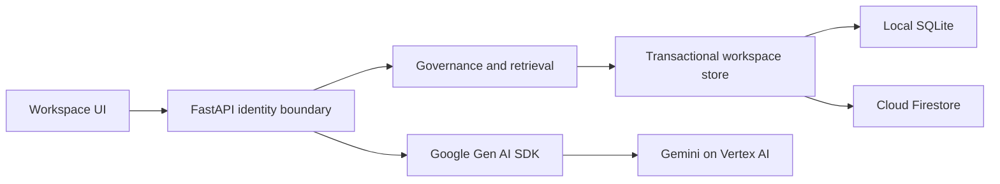

# Architecture

## Decision ADR-001: one deployable service

FastAPI serves a buildless HTML/CSS/JavaScript client and JSON API. Domain logic stays separate from transport, storage and model integration. This intentionally simplifies the blueprint's proposed Next.js/FastAPI pair for the short hackathon window. The UI needs no Node build toolchain.

## Decision ADR-002: bounded transactional workspace aggregate

A workspace contains contexts, immutable revision bodies, proposals, tasks and audit events. Local SQLite serializes mutations with BEGIN IMMEDIATE; Firestore uses a transaction on a per-workspace document. A strict serialized-size cap prevents exceeding Firestore's document limit. This is deliberately a bounded hackathon store; it is not an enterprise scaling claim. Migration to separate context/revision/run collections and object storage is required for larger projects. Never silently prune audit or revision history to fit the cap.

## Decision ADR-003: identity and authority

Demo mode issues an opaque HttpOnly SameSite cookie and isolates each browser's synthetic project. Persona changes are explicit demo impersonation. Firebase mode verifies bearer tokens and consumes administrator-set contextos_workspace and contextos_role claims. Browser-provided roles are never authoritative in Firebase mode. Default demo is unsuitable for confidential data. Cloud uses secure cookies.

Domain ownership: PM owns requirements, Architect architecture, QA quality, Developer implementation, Security security. All visible-context changes are proposals; only the designated domain owner can approve, and not their own proposal. Restricted context is visible only to Security. Every derived view rechecks all its source visibility. Approval and publication are one atomic operation; immutable proposals cannot be edited after approval.

## Retrieval and model boundary

Accepted authorized documents only. Include mandatory constraints, expand explicit dependency links, rank remaining candidates lexically, then fit whole documents into a disclosed conservative byte-based estimate. A mandatory overflow returns a clear error. Record exact payload sources before invocation. Gemini cannot publish, set roles, or modify policy. Source text is untrusted data. No model tool has write authority. Provider errors fail visibly rather than silently falling back.

## Change awareness

Publication walks explicit reverse dependency links, marks affected runs stale, and appends an audit event in the same transaction. Rerun creates a new snapshot. A source changed during inference also makes the completed run stale. Historical source bodies remain attached to the original manifest.

## Limits

Single bounded workspace aggregate; lexical retrieval; conservative estimates are not actual model token counts. Production Firebase sign-in UI, multi-project administration, queues, semantic search, custom policies and Cloud Storage revision objects are follow-up work.

## Decision ADR-004: isolated executable demo cases

The Demo tab reads a scenario catalog from `/api/demo/scenarios` and executes `/api/demo/scenarios/{id}` only in demo authentication mode. Each request creates a fresh in-memory synthetic domain state and uses the same authorization, proposal, review, retrieval and snapshot functions as the normal workspace. Rehearsal output explicitly uses the offline AI adapter even if the application has a live model configured. Results are transient UI-session evidence; they are not added to the workspace's task/audit/usage records.

This proves domain behavior without changing user data. The conflict scenario models two proposals against the same revision, while actual concurrent storage publication is separately tested by the regression suite. These demonstrations do not validate Firestore, live Gemini, or real Firebase sign-in. Hands-on links deliberately change the demo persona and open the relevant normal workspace view.

## Persona guidance and action ledger

`domain.next_actions` derives structured suggestions from the same role-filtered snapshot: independent domain-owner reviews, the persona's stale tasks, a role task goal and proposal authoring. UI dispatches only known action kinds. These are deterministic suggestions; no model chooses permissions or publishes changes.

Audit records optional role, outcome, source_ids and private_role, compatible with older events. Snapshot applies both direct context visibility and source dependency visibility to events. Task/inspection events reference all manifest sources. Domain failures are persisted in a separate transaction after the rejected mutation rolls back, without hidden target IDs or submitted content. A full workspace may prevent that append; original error responses are preserved. Prototype logging is not a tamper-proof compliance store.

Current theme (18 October): royal-blue navigation and accents, an off-white canvas, white cards, and pale-blue interactive surfaces replace the earlier brown/beige palette. Typography and layout remain from 4e1bd51 and the subsequent action-first work. Shared CSS tokens cover workspace and sign-in surfaces, with lighter sidebar accents for contrast. Font CSS and binaries are allowed only from fonts.googleapis.com and fonts.gstatic.com; system fallbacks keep UI usable offline.

## Selected Firebase identity and storage (18 October)

Owner chose Firebase Auth + Firestore + Cloud Run. Identity contract is design/specs/identity.md; Firebase-mode browser sessions use HttpOnly eight-hour cookies and CSRF-bound exchange, with trusted workspace/role claims and per-request revocation checks. Browser credentials go to Firebase REST and no ID/refresh tokens are persisted. The existing Bearer interface remains for API consumers.

Store initialization now distinguishes real empty workspaces from synthetic demo baselines, without modifying existing records. Firestore client rules deny direct browser access; server-side access uses IAM plus domain checks. The bounded JSON aggregate and atomic transaction boundary are retained. Supabase is not the selected provider; migration/normalization and live multi-instance/restore evidence remain separate work.

The collaboration verifier is an external API client, not a second implementation
of domain rules. An injected client factory runs the same scenario against local
TestClient sessions or staging HTTP. Authentication, publication, retrieval and
audit stay behind the existing service boundary. Tokens enter only through the
operator environment; output excludes credentials and content. Offline mode
requires an explicit flag. No application endpoints or storage schema changed.

## Decision ADR-005: three primary workspace destinations

Work, Knowledge and Inbox use the existing filtered workspace snapshot and API.
A single route resolver preserves overview/tasks/reviews links; activity/usage
and demo remain secondary. UI helpers project independent owned reviews and
affected personal runs for attention counts; the server continues to authorize
every action. Work's source panel reads the selected run's immutable manifest,
not the latest accepted body. Drafts/budgets use session storage and clear with
protected buffers. No new backend service, schema or publication authority was
introduced. These are standalone runs, not persisted chat conversations.

## Decision ADR-006: private conversations through an application service

ConversationService coordinates the existing transactional workspace store and
AI adapter. FastAPI validates identity/input; pure domain helpers enforce source
visibility, stale dependencies and shared call quotas. Accepted project memory
remains shared; task transcripts are private to their creator and fixed role.
Old aggregate payloads gain conversation metadata lazily and reuse the tasks
collection for ordered per-turn runs. Standalone tasks remain compatible.

Each turn reserves quota and an attempt lease atomically, invokes the model
outside the transaction, then atomically records outcome/usage/audit. Request
keys deduplicate turns; attempt IDs fence late results after lease recovery.
Retries retain the original manifest. Historical messages reference immutable
turns and remain untrusted working state; explicit refresh starts a new segment
against current accepted context. Every history source is reauthorized, including
in exports/activity; revocation hides the entire conversation conservatively.
History/output and workspace caps fail visibly rather than silently truncate.
See design/specs/conversations.md for API, recovery semantics and prototype limits.
This slice adds the backend only; the chat UI and live cloud checks remain open.

## Decision ADR-007: restore an actionable project overview

Owner requested Overview back alongside Work, Knowledge and Inbox, superseding
ADR-005's three-link navigation and Overview alias. Overview is the default route
and uses the existing permission-filtered workspace snapshot; no new API/storage
or policy authority is introduced. The controller projects personal actions and
visible project counts without changing accepted knowledge. Critical means a
stale personal run loaded a required source whose accepted revision changed;
details identify that source and both revisions. Other reviews, base conflicts,
latest failed calls and stale runs retain descriptive labels. Inspection uses
the original run, and review links open the appropriate Inbox filter. Snapshot
refresh shares the protected-generation guard used by Inbox and Activity.

## Controller integration with shared-knowledge pages

The route resolver normalizes /knowledge and contextpages/tasks/reviews aliases
to current workspace views. Rendering retains current navigation/dispatch and
clears the shared-knowledge module before mounting its next root. Browser history
updates preserve query strings. Protected cleanup increments the workspace
generation and clears the page module, whose own generation cancels pending
loads. Integration fixtures load both real modules and supply location/history;
CI runs these contracts alongside the context-page/map suite. This repairs the
merge boundary without changing backend authority or context storage.

## Live MVP topology — 18 October 2026

Google Cloud project contextos-512006 now hosts the team and synthetic demo services in Cloud Run asia-south1, with Firestore Native in the same region. Team sessions verify signed membership and use live Vertex AI in global; public walkthrough disables AI calls. PUBLIC_ORIGIN provides the exact advertised HTTPS origin for write checks behind the hosting proxy; forwarded headers cannot choose the allowed origin. Dedicated runtime/build IAM and the custom two-permission session role are documented in deployment/verification.md. This is an MVP deployment; no enterprise operations certification is implied.

### Project persistence boundary (d01509d review)

Context-page routes use a project-store interface. LocalProjects maintains storage/projects.json plus Markdown objects with an in-process shared lock and atomic registry replacement; local demo sessions discover the same projects. Local verified workspaces retain an internal access scope. FirestoreProjects delegates to the existing authorized workspace transaction store and returns exact stored Markdown, with no disk dependency or fallback. Cloud Run selects this provider explicitly. Missing local metadata exposes a read-only recovery notice; original metadata is required to restore governance history. Multi-process local registry writes are outside this MVP's supported topology.
